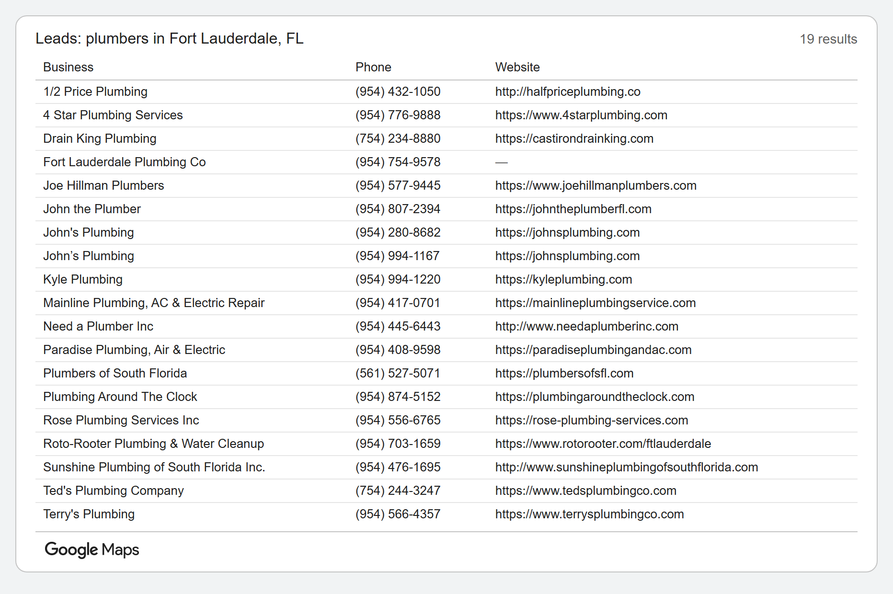

# Local Lead Scraper

A Python tool that collects local business leads from the Google Places API, cleans the data, and saves it into a SQL database. It is safe to run on a schedule: businesses it has already seen are updated, never duplicated.

## The problem

Lead lists go stale and get messy. The same business shows up in every run, phone numbers come in a dozen formats, websites carry tracking junk, and some fields are simply missing. A script that crashes on a duplicate, or fills the database with copies, is not usable on a schedule.

## What it does

- **Fetches** local businesses (name, address, phone, website) from the Google Places API (New).
- **Cleans** each record:
  - trims extra spaces from names and addresses
  - standardizes US phone numbers to `(954) 555-0101`
  - lowercases websites and removes tracking parameters and trailing slashes
  - keeps missing phones and websites as empty instead of crashing
- **Saves** to a SQLite database with upsert logic (`ON CONFLICT ... DO UPDATE`). A repeat run updates existing leads, and a blank value in new data never erases a value already saved.
- **Skips bad records** and logs a clear warning, so one bad place never stops the whole run.
- **Protects your API budget** with a hard daily limit on real Google calls, counted before each call.
- **Tested** with 17 automated tests.

## Cleaning example

Here is what the tool does to a small sample. All names, numbers, and websites in this example are made up.

**Before: as the data arrives**

| Business | Phone | Website |
|---|---|---|
| Coastal Pro Plumbing | (954) 555-0101 | https://www.coastalproplumbing.example.com/?utm_source=google |
| Harbor  Drain Experts (extra spaces) | 954.555.0102 | HTTP://HarborDrainExperts.example.com/ |
| Bayside Plumbing & Rooter | 954 555 0103 | *(missing)* |
| Sunshine Water Heaters | *(missing)* | https://sunshinewaterheaters.example.com |
| A1 Leak Detection | +1 954-555-0105 | https://a1leakdetection.example.com/contact/ |
| Harbor Drain Experts (listed a second time) | (954) 555-0102 | https://harbordrainexperts.example.com/ |
| Palm Road Plumbing Co. | 5165550106 | *(missing)* |

**After: cleaned and saved**

| Business | Phone | Website |
|---|---|---|
| Coastal Pro Plumbing | (954) 555-0101 | https://www.coastalproplumbing.example.com |
| Harbor Drain Experts | (954) 555-0102 | https://harbordrainexperts.example.com |
| Bayside Plumbing & Rooter | (954) 555-0103 | *(missing)* |
| Sunshine Water Heaters | *(missing)* | https://sunshinewaterheaters.example.com |
| A1 Leak Detection | (954) 555-0105 | https://a1leakdetection.example.com/contact |
| Palm Road Plumbing Co. | (516) 555-0106 | *(missing)* |

What changed: phone numbers now share one format, tracking junk and trailing slashes are gone from websites, extra spaces are trimmed, and the business listed twice is saved once, with its details updated.

## Results on the sample data

The included sample reply has 7 records, and one business appears twice with different details.

| Run | Inserted | Updated | Leads in database |
|---|---|---|---|
| First run | 6 | 1 | 6 |
| Second run (same data) | 0 | 7 | 6 |

Running it again never creates duplicates.

## Example output

A live search for "plumbers in Fort Lauderdale, FL" returned 19 businesses using 1 Google call. All 19 were cleaned and saved, and missing phones and websites were left empty. Content from Google Maps is marked with the Google Maps logo.



## How to run

1. Install the libraries:

```
   pip install -r requirements.txt
```

2. Run it on the included sample data. This makes no real Google calls:

```
   python scraper.py
```

3. Run the tests:

```
   python -m pytest
```

### Using real data

1. Create a `.env` file in the project folder containing one line:

```
   GOOGLE_API_KEY=your-key-here
```

   The `.gitignore` keeps this file out of Git, so your key is never uploaded.

2. Run a live search:

```
   python scraper.py --live "plumbers in Fort Lauderdale, FL"
```

Each live run makes one Google call. The script refuses to make more than 10 real calls in a day to keep costs down.

## Project files

| File | Purpose |
|---|---|
| `scraper.py` | Main program: fetch, clean, save, and the daily call limit |
| `cleaning.py` | Functions that clean names, phones, and websites |
| `database.py` | Creates the table and handles the upsert |
| `test_leads.py` | Automated tests |
| `sample_response.json` | Made-up sample of Google's reply, for testing at no cost |
| `requirements.txt` | Libraries the project needs |

## Built with

Python, SQLite, requests, python-dotenv, and pytest.

## Planned next

- Move the database from SQLite to PostgreSQL
- Package the project with Docker
